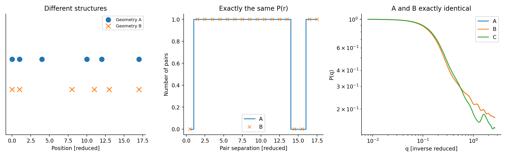
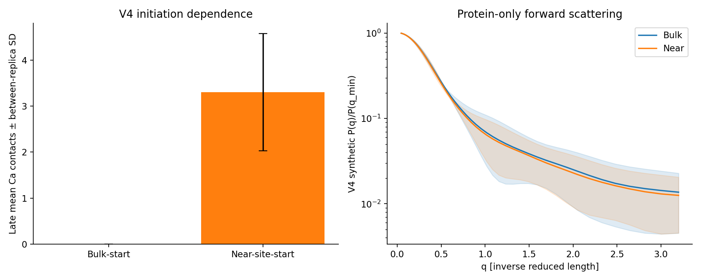

# CaCasein-MD-SAXS

**An independent, CPU-friendly coarse-grained simulation and SAXS inverse-problem methods portfolio project.**

> **Scientific status:** V1–V4 use simplified *casein-inspired* (not experimentally calibrated) Langevin MD models. V5 is an independent scattering / identifiability analysis and retrospective audit, **not new MD**. The reported scattering is synthetic. There is **no validated calcium–casein affinity, Martini 3 run, or matched experimental SAXS fit**. This repository is a computational demonstration, not a published biological finding.

## Highlights

- Implemented and tested forward scattering using the isotropic point-scatterer Debye equation.
- Compared three discretized sphere realizations (850 points each) to the analytical sphere form factor: **RMS normalized intensity error = 0.002945** over the documented q range. This tests numerical scattering only.
- Constructed **two different six-point arrangements with exactly the same 15 pair distances**, giving nearly identical SAXS curves (maximum absolute numerical discrepancy **3.33 × 10⁻¹⁶**). These are mathematical examples, **not casein conformations**.
- Performed **60 independent synthetic-noise inverse-model trials**; structurally non-unique A/B candidates remain observationally indistinguishable under SAXS alone.
- Reanalyzed **15 existing V4 reduced-unit MD trajectories** showing strong sensitivity of apparent calcium-like bead contacts to ion initial position (0.00 vs 3.30 mean late contacts for the matched 8-ion setup). **This is an undersampling warning, not a binding-constant measurement.**
- **36 existing tests pass locally**, including physics invariances and independent numerical checks.

## Figures (computed, not experimental)

| Exact SAXS non-identifiability | V4 ion-initialization audit |
|:--:|:--:|
|  |  |

## Quick start — Linux / CPU

Requires Python 3.10+ and a few scientific-Python packages. From the repository root:

```bash
python3 -m venv .venv
source .venv/bin/activate
python -m pip install --upgrade pip
python -m pip install -r requirements.txt
python -m pytest -q tests v2_sequence_calcium/tests v3_explicit_ca/tests v4_validation/tests v5_saxs_identifiability/tests
python v5_saxs_identifiability/run_v5.py --v4 v4_validation --out results_recomputed
```

The V5 script saves numeric CSVs, figures, and a machine-readable `results_summary.json` in `results_recomputed/`. Archived reference outputs from 29 October 2026 are in `v5_saxs_identifiability/results/`. Run times depend on hardware.

For a V5-only environment, install `v5_saxs_identifiability/requirements_v5.txt` instead. The **whole-project** test command uses top-level `requirements.txt`, which also installs Numba used in V1–V4.

## Study structure

| Directory | Scientific scope | Status |
|---|---|---|
| `tests/`, `cacasein_md_saxs.py` | Basic bead–spring Langevin MD + Debye scattering | Synthetic, executed |
| `v2_sequence_calcium/` | Sequence-informed β-casein-inspired chain model, effective attraction | Synthetic, executed |
| `v3_explicit_ca/` | Mobile calcium-like bead proxies | Synthetic, executed |
| `v4_validation/` | Ion-initialization controls + longer sampling checks | Synthetic, executed |
| `v5_saxs_identifiability/` | Independent sphere benchmark, homometry, inverse uncertainty, V4 reanalysis | Synthetic, executed |
| `docs/` | Project integrity, development history, release notes | Documentation |

**V5 research details, equations, caveats and literature references:** [v5/README.md](v5_saxs_identifiability/README.md).

**V4 validation details:** [V4 results](v4_validation/RESULTS_V4_EN.md).

**Persian-language instructions:** [V5 Persian guide](v5_saxs_identifiability/START_HERE_FA.md).

## Reproducibility and provenance

- All archived V5 numerical results are generated by `v5_saxs_identifiability/run_v5.py` using the stated deterministic seed. Independent V1–V4 archived trajectories are provided for audit.
- All q/length axes in the custom models are **uncalibrated reduced units**, not physical `nm⁻¹` / `nm`.
- The optional experimental importer (`analyze_experimental_saxs.py`) requires a user-supplied file; **no experimental curve was ingested** in the archived results.
- Shape2SAS is cited as methodological context, but **the original Shape2SAS application has not been run or directly cross-validated here**.
- No credentials, personal data, lab measurements, or third-party proprietary datasets are included.
- Source citation and scientific limitations: [V5 research notes](v5_saxs_identifiability/README.md).

## References

Larsen AH, Brookes E, Pedersen MC, Kirkensgaard JJK (2023). Shape2SAS. *Journal of Applied Crystallography* 56, 1287–1294. https://doi.org/10.1107/S1600576723005848

Shape2SAS reference implementation: https://github.com/andreashlarsen/Shape2SAS

**Reuse licensing:** no reuse license has yet been selected. Please request permission from the repository owner before redistributing or reusing the source.
